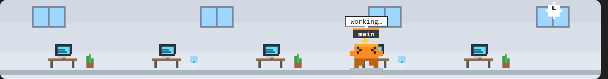
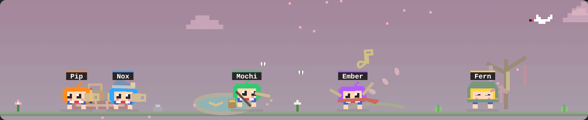
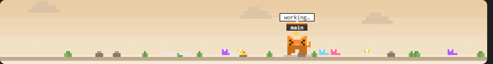
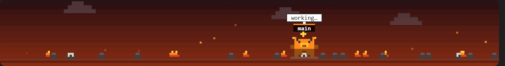
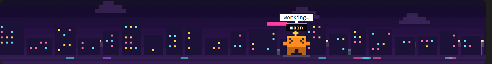
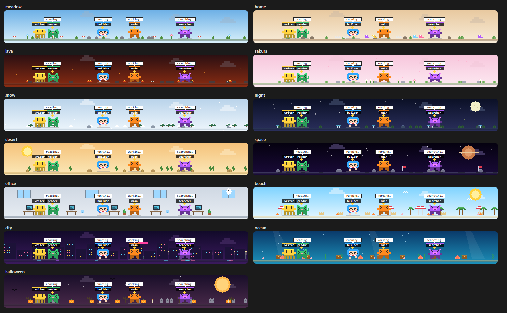

# agent-avatars

A [Claude Code mod](https://code.claude.com/docs/en/plugins/mods/overview) that puts a tiny pixel-art world above the prompt. The main agent and every subagent are little pixel characters (robots, cats, dragons, anime kids):

- **Working:** the robot walks around the scene, hops, and shows what it is doing in a speech bubble (`reading…`, `searching…`, `running…`, `writing…`, `browsing…`, `delegating…`).
- **Idle or done:** it stands still, blinks and sleeps (`z z`).
- **Enter and exit:** a new subagent pops in with a bounce; a finished one flickers, floats up and vanishes in a puff of pixels after 15 seconds.
- **Scenery:** a themed little world on a transparent background (or with a sky, if you like), with drifting pixel clouds.



| Anime, sakura scene | Cats at home |
| --- | --- |
|  |  |
| **Dragons in lava land** | **A mixed party in the neon city** |
|  |  |

The scene is a single SVG animated with SMIL, so it costs almost nothing: no JavaScript runs per frame and nothing is redrawn while the agents stay in the same state.

## Install

In a terminal Claude Code session:

```
/plugin install agent-avatars --marketplace vanyastaff/agent-avatars
```

Answer `y` to add the marketplace, then pick a scope. The mod is active right away.

## Choose your characters and world

Open `/config` and find the mod's rows. After a change the mod reloads by itself.

| Option | Values | Default |
| --- | --- | --- |
| `skin` (Character) | `robot`, `cat`, `dragon`, `anime`, `mixed` (every agent is a different one) | `robot` |
| `scene` (Scene) | `auto` (follows the character), `meadow`, `home`, `lava`, `sakura`, `snow`, `night`, `desert`, `space`, `office`, `beach`, `city`, `ocean`, `halloween` | `auto` |
| `sky` (Background) | `transparent`, `filled` (paints a sky behind the scenery) | `transparent` |

Scenes at a glance: `office` has desks with flickering monitors and your agents walk from desk to desk; `beach` has palms, umbrellas and gulls; `city` is a neon skyline at night; `ocean` has seaweed, coral, treasure chests and rising bubbles; `halloween` has pumpkins, tombstones and bats under a big moon.

All 13 scenes (the animated parts are in the GIFs above):



### Names and speech bubbles

| Option | Values | Default |
| --- | --- | --- |
| `names` (Agent names) | `static` (the task text as is), `short` (trimmed to the point, free), `ai` (a small model coins a name) | `short` |
| `thoughts` (Speech bubbles) | `static` (`reading…`, `running…`), `action` (what the agent just did: `read switch.rs`, `$ cargo test`; free), `ai` (a small model sums up the last actions) | `action` |

`short` turns "Implement T9 Switch and NavigationBar" into "T9 Switch…". `ai` calls a small model (Haiku, a few tokens per reply): one request per new agent for the name, and at most one every 12 seconds per working agent for the bubble. Those requests use your Claude usage, which is why both are opt-in. The reply is only ever drawn as plain text.

Each agent keeps its own colour (for the anime characters that is the hair colour), so you can tell them apart in any skin.

## Troubleshooting

Run `/avatars` to see which agents the scene is drawing next to the agents the session itself reports. If an agent is in the second list but not the first, please open an issue with that output.

## Where it draws

| Surface | What you get |
| --- | --- |
| Desktop app (Code tab) | The animated pixel scene |
| Terminal | A block-character robot per agent, redrawn four times a second |

## How it works

`hooks/register.tsx` hooks `agent.spawn`, `tool.call`, `turn.complete` and `ui.render` (the `AbovePrompt` band). Each agent walks a looping route generated from a seeded random generator, and the animation phase is kept across redraws, so robots do not jump when something else changes.

The mod only reads session events and draws; it does not touch files, run processes or call the network. You can check that yourself:

```
claude plugin validate .
```

## License

MIT
