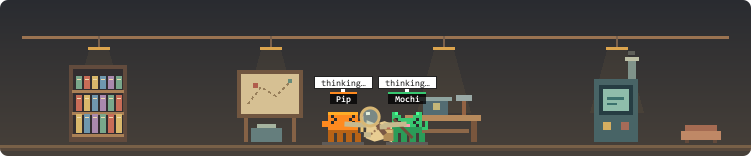

# agent-avatars

A [Claude Code mod](https://code.claude.com/docs/en/plugins/mods/overview) that puts a tiny pixel-art world above the prompt. The main agent and every subagent are little pixel characters (robots, cats, dragons, anime kids):

- **Working:** characters plan, think, write replies, and interact with the selected world's objects. Every world has reachable reading, searching, crafting and running places; actors settle there instead of walking forever.
- **Idle or done:** it stands still, blinks and sleeps (`z z`).
- **Enter and exit:** a new subagent pops in with a bounce; a finished one flickers, floats up and vanishes in a puff of pixels after 15 seconds.


- **Scenery:** a themed little world on a transparent background (or with a sky, if you like), with drifting pixel clouds.


| Anime, sakura scene | Cats at home |
| --- | --- |
|  |  |
| **Dragons in lava land** | **A mixed party in the neon city** |
|  |  |

The scene is a single SVG animated with SMIL, so JavaScript does not compute each animation frame. A 250 ms housekeeping timer expires temporary effects, and every two seconds the mod checks agent statuses and the theme. The desktop scene is invalidated when its state changes; the terminal redraws four times a second.

## Install

In a terminal Claude Code session:

```
/plugin install agent-avatars --marketplace vanyastaff/agent-avatars
```

Answer `y` to add the marketplace, then pick a scope. The mod is active right away.

## Choose your characters and world

Open `/config` and find the mod's rows. After a change the mod reloads by itself.

| Option | Values | Default |
| --- | --- | --- |
| `skin` (Character) | `robot`, `cat`, `dragon`, `anime`, `mixed` (every agent is a different one) | `robot` |
| `scene` (Scene) | `workshop`, `auto` (follows the character), `meadow`, `home`, `lava`, `sakura`, `snow`, `night`, `desert`, `space`, `office`, `beach`, `city`, `ocean`, `halloween` | `workshop` |
| `behavior` (Behavior) | `cozy`, `chaotic`, `adventure` | `cozy` |
| `liveliness` (Liveliness) | `quiet`, `normal`, `lively` | `normal` |
| `sky` (Background) | `transparent`, `filled` (paints a sky behind the scenery) | `transparent` |
| `look` (Light or dark) | `auto` (follows your Claude Code `theme`, and the system when that says auto), `dark`, `light` | `auto` |

Scenes keep their own skies, ambient details and colors, and now include usable
objects. `auto` still selects meadow for robots, home for cats, lava for dragons
and sakura for anime characters.

### Places and actions in every world

Version 0.8.0 gives all 14 scenes four work places. Each row follows the same real
events: Read/NotebookRead, search/scouting tools, Edit/Write, and command tools.

| Scene | Reading | Searching | Crafting | Running |
| --- | --- | --- | --- | --- |
| workshop | Library | Map board | Workbench | Engine |
| meadow | Field journal | Butterfly patch | Seedling bed | Water wheel |
| home | Reading sofa | Toy chest | Sewing table | Kitchen stove |
| lava | Rune tablet | Crystal vein | Forge anvil | Bellows furnace |
| sakura | Poetry stand | Koi pond | Bonsai bench | Tea hearth |
| snow | Expedition board | Snow drift | Ice sculpture | Camp stove |
| night | Star atlas | Observatory telescope | Lantern bench | Campfire |
| desert | Explorer map | Dig site | Mosaic table | Oasis pump |
| space | Star chart console | Radar dish | Repair dock | Reactor console |
| office | Archive cabinet | Search terminal | Drafting desk | Office printer |
| beach | Tide chart | Shell sorting tray | Sandcastle | Water pump |
| city | News kiosk | Transit map | Repair stall | Signal cabinet |
| ocean | Shell archive | Coral survey | Pearl bench | Air pump |
| halloween | Spell lectern | Clue pumpkin | Potion bench | Cauldron |

Characters reach toward the object, read on the home sofa, guide fabric through
the sewing machine, turn a wheel, tend a kettle, feed paper, carve ice or stir a
cauldron. The object responds only while a matching actor is there and free of an
approval wait or duet. A failed tool produces a trouble cue; it does not imply a
failed turn or that the problem was fixed. These remain visual metaphors for
tool kinds, never deductions from command text, model reasoning or message text.

All scenes use a 156-unit band to leave room for the objects and labels. Routes
approach once within 2.2 seconds and stop. After a real result the actor completes
its closing gesture at the object before moving to a thinking place; the actual
tool status changes immediately. Fast results keep a bounded visual postlude
after arrival, without delaying the tool. Resizing replans the approach.
Personality, behavior presets, quiet mode and event-driven duets still apply.

See the [all-world gallery](docs/previews/worlds.html) and the static contact
sheets: [first seven worlds](docs/previews/worlds-1.png),
[remaining seven worlds](docs/previews/worlds-2.png). Wide and 360-pixel light,
transparent, quiet variants use the production renderer.

The original 13 scenes (the animated parts are in the GIFs above):


### A workshop full of characters

The new default `workshop` has a library, map board, workbench, engine and tea
corner. A tool call sends the agent to the matching station. The actor stops
walking when it gets there and works with an object. Small stages spread the
actors out and keep secondary speech bubbles in tooltips to avoid crowding.


Personality is independent of skin: even five identical robots have different
accessories and habits. Meticulous carries a pencil and lines up parts; Curious
wears a satchel and investigates a box; Dramatic wears a scarf and makes a show;
Sleepy has a nightcap and yawns; Shy wears a hood and tends a little plant.
Personality and colour stay with the avatar when its activity changes.

`behavior` changes the performance: **cozy** uses books, notebooks and warm cups;
**chaotic** adds upside-down books, magnets, a butterfly net and an enormous
mallet; **adventure** uses scrolls, maps, compasses and lanterns. All skins and
scenes can use all three behaviors. These are cosmetic roles, never instructions
to the real agent.

`liveliness` controls motion and autonomous personality moments. Quiet, normal
and lively offer a short moment every 30, 16 or 8 seconds respectively, with one
actor performing at a time. Waiting, completion, messages and other event
reactions take priority. Quiet reduces decorative motion; the SVG also respects
`prefers-reduced-motion` for actor/prop transforms. Sounds remain opt-in.

### The scene follows the hooks

| Event | Reaction |
| --- | --- |
| `turn.start` | Planning, with a map or task notes |
| `turn.step` | Thinking; switches to writing a reply when text streams |
| `tool.call` | Reading, searching, crafting, running, browsing or dispatching with matching props |
| Tool returns | Returns to thinking; a brief object receipt makes even fast tools visible |
| Tool reports an error | An error marker, without pretending the whole turn failed |
| `tool.check` asks on an active call | Approval wait with a key; the original permission verdict is preserved |
| `command.run` | Checks a small task board |
| Accepted `config.set` | A stage-settings gear; behavior and liveliness update |
| `session.compact` | Bundles a stack of notes |
| `session.send` / `session.receive` | Meetings between known actors / a received envelope |
| `agent.spawn` / `turn.complete` | Arrival / happy, failed or interrupted turn outcome |

Parallel tools retain their own activity: when the newest call finishes, an
older still-running call is shown again. After all tools return, the avatar
thinks instead of showing a stale `reading…` status. Message contents and model
reasoning are not used for the decorative event reactions.

### Names and speech bubbles

| Option | Values | Default |
| --- | --- | --- |
| `names` (Agent names) | `static` (the task text as is), `short` (trimmed to the point, free), `ai` (a small model coins a name) | `static` |
| `thoughts` (Speech bubbles) | `static` (`reading…`, `running…`), `action` (what the agent just did: `read switch.rs`, `$ cargo test`; free), `ai` (a small model sums up the last actions) | `static` |

`short` turns "Implement T9 Switch and NavigationBar" into "T9 Switch…". `ai` calls a small model (Haiku, a few tokens per reply): one request per new agent for the name, and at most one every 12 seconds per working agent for the bubble. Those requests use your Claude usage, which is why `ai` is opt-in. Everything is `static` by default, and nothing calls a model unless you switch it on. The reply is only ever drawn as plain text.

On a light theme the pale things that would vanish (clouds, stars, snow, gulls) switch to a darker blue-grey, so the transparent scenes stay readable on both.

Each agent keeps its own colour (for the anime characters that is the hair colour), so you can tell them apart in any skin.

## Moods and sounds

Agents react to how things end, without reading tool calls or prompts:

- `✓ done`: the turn ended normally, the character hops happily (`^ ^` eyes).
- `! failed`: the turn ended with an error or a refusal, the character shakes (`x x` eyes).
- `stopped`: the turn was interrupted.
- `? your turn`: Claude is asking you a question (the main character waits while the dialog is open).
- `? waiting`: a subagent is blocked on approval or on something it started.

The main character's mood clears after a few seconds; a subagent keeps it until it leaves the scene.


### Agents talking to each other

Version 0.7.0 replaces the time-seeded chat emotes with short, event-driven
duets. A delivered message becomes a handoff: Meticulous folds the note neatly,
Curious checks both sides, Dramatic makes a presentation, Sleepy yawns, and Shy
slides it over gently. An undelivered message never starts a handoff.



Successful spawns can receive a workshop kit from their actual parent. A tool
error can bring an idle teammate over to inspect the troublesome part; a normally
answered turn can get a shared finish. Helpers never leave an active tool or
approval wait to perform. These scenes acknowledge real events: an inspection
does not claim that the error was repaired, and a turn ending does not infer test
or build success.

Only one duet runs at a time. It approaches, exchanges an object, reacts, and
returns to work within 4.4 seconds. Real tools, new turns, questions, approvals,
retirement and resizing interrupt both participants together. Busy events are
not queued for later. Quiet mode keeps actors at their existing positions;
reduced-motion styling suppresses duet travel while retaining the scene's meaning.

Only who writes to whom is read, never the text. The main agent is addressed as `main`, others by the name their Agent call gave them or by agent id.

### Actions with a beginning and an ending

| Real tool activity | Visual sequence |
| --- | --- |
| Read / NotebookRead | Select a reference, study the pages, take notes, return it |
| Grep / Glob / ToolSearch | Unfold the search map, trace clues, mark the area, fold it |
| Edit / Write / NotebookEdit | Lay out tools, fit a part, refine it, put tools away |
| Bash / PowerShell / Monitor | Prime a mechanism, watch gauges, tend it, wind it down |
| WebFetch / WebSearch | Extend a telescope, survey, sketch a route, stow the gear |

Personality changes the posture and handling; behavior presets keep their own
objects and motion. Workshop approaches take at most 2.2 seconds. A long tool
holds its working beat until it actually returns. Fast tools receive a bounded
2.2-second result sequence while their actual status is already thinking. A
denied or failed call sets its tool aside rather than acting out a successful
result. Parallel calls retain their own elapsed beats; late results from an old
turn cannot restart an obsolete action. Current beats are also described in SVG
alternative text and in the terminal. Autonomous flourishes yield to these actions.

The [choreography gallery](docs/previews/choreography.html) and
[static contact sheet](docs/previews/choreography.png) show stages and duets.

### Pull requests and CI

If your session receives GitHub events (for example while it watches a pull request), the scene reacts without writing anything: a merged pull request sets off fireworks and confetti and every character cheers; a failed CI run makes them sad. Only the event's kind and outcome are read. Switch it off with `events: off`.


Short 8-bit blips can play when an agent appears, finishes, fails or asks you something. They are off by default (`sound`: `off` / `on`). The engine plays them through `afplay`, so they work on macOS only; on Windows and Linux the option does nothing.

## Troubleshooting

Run `/avatars` to see which agents the scene is drawing next to the agents the session itself reports. If an agent is in the second list but not the first, please open an issue with that output.

## Where it draws

| Surface | What you get |
| --- | --- |
| Desktop app (Code tab) | The animated pixel scene |
| Terminal | A block-character robot per agent, redrawn four times a second |

## How it works

`hooks/register.tsx` observes turn, tool, command, configuration and session
events and draws the `AbovePrompt` band. `hooks/theater.ts` contains pure
personality, object and workshop artwork. `hooks/worlds.ts` owns world-specific
places, actions and object responses. All routes approach a station once; the
old looping-work routes and office-only desk routing are removed. Animation phase is kept
across redraws. Hooks pass original events, streams and results through.

The mod observes session events and draws; it does not read or write project files or start processes itself. The optional `ai` modes ask the host to call Haiku using your Claude usage, and optional sounds ask the host to play bundled audio. Both are off by default. Inspect the registered hooks and host API calls with:

```
claude plugin validate .
```

## Development and tests

Run the regression tests with Claude Code's built-in mod test runner (verified
with Claude Code 2.1.292):

```
claude plugin test .
claude plugin validate --strict .
```

No Node.js packages, sign-in, or model requests are needed. Tests load the real
hooks through `register`, stub host APIs, and advance a controlled host clock.
They check agent retirement and resumption, main-agent activity, SVG text escaping,
AI opt-in and throttling, and tool execution when the observer's host API fails.
The 74-test suite also covers event-driven duets, all five personality roles,
multi-stage/fast actions, busy recipients, delivery failures, parallel-call
continuity, interruption, resize, approval waits and old-turn result isolation.
It additionally checks every world's reachable places and actual tool actions,
narrow resizing, object activity only after arrival, permission/failure behavior,
fast-result postludes and all four automatic skin-to-world mappings.
Desktop and VS Code SVG output and terminal elements are checked through the
[native test kit](https://code.claude.com/docs/en/plugins/mods/test); application
painting and SMIL playback still need a real session.

For a visual gallery generated from the production SVG functions, run
`node scripts/preview.mjs` with Node 24. It writes `docs/previews/index.html` and
the three behavior SVGs plus `docs/previews/choreography.html` and
`docs/previews/worlds.html`; open the HTML in a
browser to inspect SMIL playback.
The bundled Sharp package can optionally generate PNGs with `--png` when
`CODEX_WORKSPACE_NODE_MODULES` points to the bundled Node packages directory.

## License

MIT
